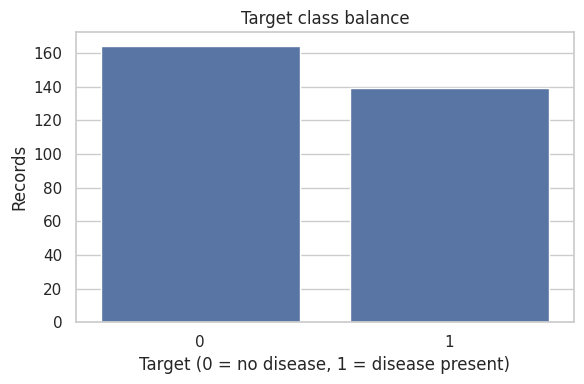
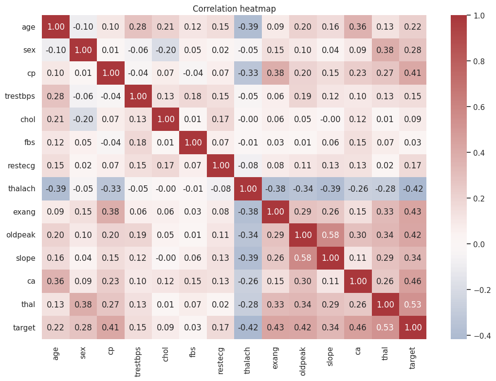
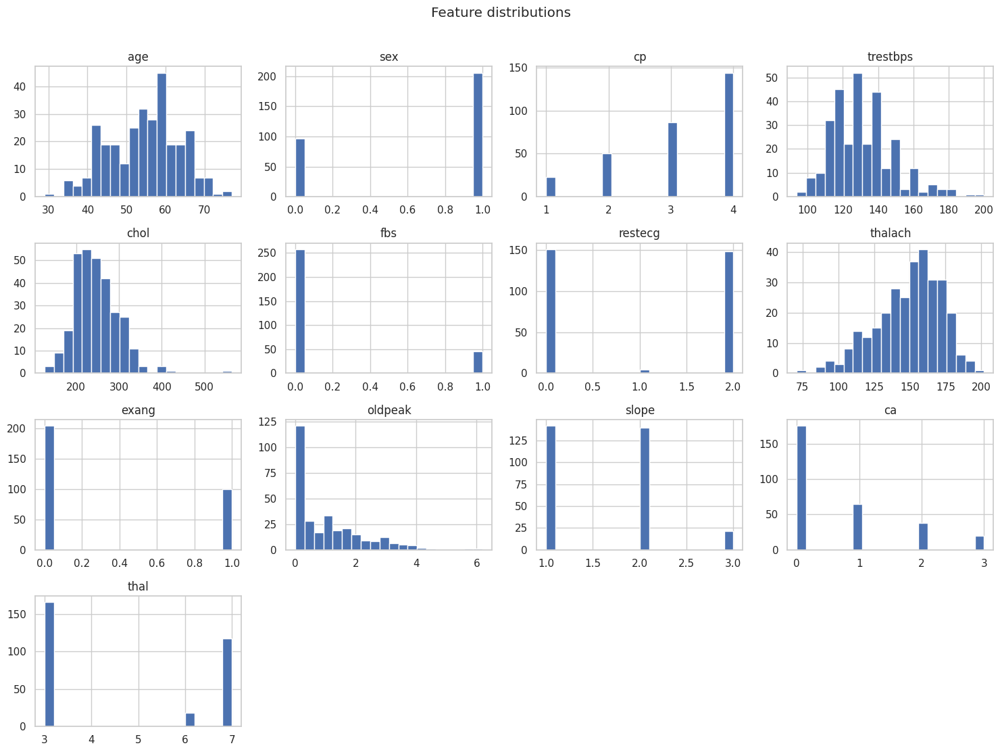
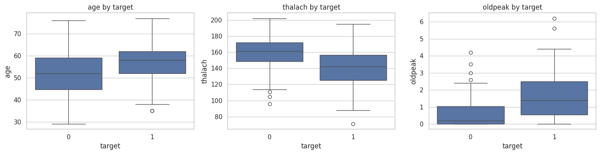

# End-to-End MLOps for Heart Disease Classification

**Course:** AIMLCZG523 — Machine Learning Operations  
**Assignment:** 01  
**Student:** [Add your name and ID]  
**Date:** [Add submission date]

> **Evidence policy:** This report is a submission-ready structure, but measured values, screenshots, repository URL and deployment URL must come from your own run. Do not claim that deployment or CI passed until you have verified it.

## Abstract

This project develops a reproducible classification workflow for the processed Cleveland subset of the UCI Heart Disease dataset. It connects data acquisition and exploratory analysis with preprocessing, model comparison, experiment tracking, automated testing, container-based serving, and operational metrics. Logistic Regression and Random Forest are compared using stratified cross-validation. Model selection is based on mean cross-validated ROC-AUC, while a held-out test set is reserved for final reporting. The selected preprocessing-and-model pipeline is saved as one artifact so the API applies the same transformations used during training.

This is a learning exercise and not a clinical system. The dataset is small and historically collected; measured performance cannot be assumed to generalize to present-day patients or different populations.

## 1. Problem definition and scope

The task is binary classification: map 13 patient attributes to the dataset's target. In the source, target values 0 through 4 represent increasing encoded categories; for this assignment, target 0 is mapped to class 0 and values above 0 to class 1. This simplification follows the common processed Cleveland binary framing, but it loses severity information. The model output is an educational estimate, not a diagnosis.

The system boundary includes data download, preprocessing, training, experiment logging, serialization, REST inference, request logs, metrics, CI, and a local Kubernetes option. It does not include electronic health record integration, clinical validation, identity management, or regulated deployment controls.

## 2. Data acquisition and preparation

The data loader downloads the processed Cleveland CSV from a public UCI repository mirror and assigns explicit column names. The `?` token is treated as missing and converted to numeric missing values. Rows without a target are excluded, and target values are normalized to a binary label. Missing predictor values are not imputed globally before splitting: median imputation is part of the scikit-learn pipeline and is fitted within each training fold. This avoids allowing validation-fold information to influence preprocessing.

**Data source:** UCI Machine Learning Repository, Heart Disease dataset, processed Cleveland subset. Verify source provenance and include the repository/source URL in your final submission.

**Run:** `python -m src.data --output data/heart.csv`

**Insert your observed data profile:**

- Number of rows after loading: **303**
- Number of predictors: **13**
- Missing values by feature: **`ca`: 4, `thal`: 2, all others 0**
- Class 0 / class 1 counts: **164 / 139**

## 3. Exploratory data analysis

The training script creates histograms for each predictor, a correlation heatmap, and a target class-balance chart in `artifacts/eda/`. Histograms help identify skew, unusual ranges, and potential outliers. The heatmap is a quick view of linear association, not proof of causation. The class-balance plot informs interpretation of accuracy and supports reporting precision, recall, and ROC-AUC alongside it.

**Figure 1:** 
**Figure 2:** 
**Figure 3:** 
**Figure 4:** 

Interpretation should be written after inspecting the generated figures. Note visible skew, missingness, class imbalance, and correlations without claiming that association implies causation.

## 4. Feature engineering and model development

The 13 supplied predictors are used in their source encoding. The preprocessing stage uses median imputation and standard scaling. Scaling is useful for Logistic Regression; tree-based Random Forest is less sensitive to scale, but keeping a consistent pipeline simplifies comparison and serving. The pipeline is trained only on training partitions.

A stratified 80/20 train-test split is used with a fixed random seed. The training partition uses stratified cross-validation. Logistic Regression is tuned over `C = 0.1, 1, 10`; Random Forest is tuned over estimator counts 150 and 300 and maximum depth choices `None`, 5, and 10. Grid search optimizes ROC-AUC. Final metrics on the held-out test partition include accuracy, precision, recall, and ROC-AUC. Confusion matrices and ROC curves are stored as artifacts.

**Model comparison table — populate from `models/heart_pipeline.json` and MLflow:**

| Model | CV ROC-AUC mean | Test accuracy | Test precision | Test recall | Test ROC-AUC |
|---|---:|---:|---:|---:|---:|
| Logistic Regression (C=0.1) | 0.901 | 0.869 | 0.812 | 0.929 | 0.957 |
| Random Forest | 0.885 | 0.902 | 0.867 | 0.929 | 0.956 |

The selection rule is the highest mean cross-validated ROC-AUC on the training split. Do not choose a model by looking at test performance repeatedly; the test set is intended as a final estimate. For a health-related task, false negatives and false positives have different consequences, so recall and precision deserve discussion rather than treating accuracy as the only objective.

## 5. Experiment tracking with MLflow

Each candidate model creates an MLflow run under the `heart-disease-classification` experiment. Logged parameters include model family, seed, fold count, and best grid-search parameters. Logged metrics include mean and standard deviation for cross-validation scores and held-out test metrics. Artifacts include confusion matrices, ROC curves, classification reports, and the fitted sklearn model.

Start the interface with `mlflow ui --backend-store-uri sqlite:///mlflow.db` and open `http://127.0.0.1:5000`.

**Figure 4:** [Insert screenshot showing both model runs and metrics in MLflow.]  
**Run IDs and observations:** [Add actual run IDs and a brief comparison from the UI.]

## 6. Packaging and reproducibility

The final estimator and preprocessing transformations are serialized together using Joblib. The feature order is explicitly recorded in the accompanying JSON summary. Dependencies are listed in `requirements.txt`, and the random seed is fixed for split and model initialization. Reproducibility still depends on the Python/package environment and upstream dataset availability; for a stronger production setup, pin exact dependency versions and store a checksum/versioned copy of the data.

**Model artifact:** `models/heart_pipeline.joblib`  
**Metadata:** `models/heart_pipeline.json`

## 7. API and containerization

FastAPI exposes `/health`, `/predict`, and `/metrics`. Pydantic validates incoming fields and plausible ranges before inference. The `/predict` endpoint returns a binary class, the maximum class probability, and the positive-class probability. These probabilities are model scores and should not be described as clinically calibrated risk without a separate calibration and validation study. Requests are logged with method, path, status, and duration; patient feature values are not written to application logs.

Build and run after training:

```bash
docker build -t heart-disease-api:local .
docker run --rm -p 8000:8000 -v "$(pwd)/models:/app/models:ro" heart-disease-api:local
```

**Figure 5:** [Insert successful Docker build output.]  
**Figure 6:** [Insert `/docs` and successful `/predict` response using synthetic sample input.]

## 8. CI/CD and automated testing

The GitHub Actions workflow installs dependencies, runs Ruff linting, executes Pytest, downloads the dataset, trains the candidate models, and uploads model/EDA/MLflow artifacts. The workflow fails if linting, tests, data acquisition, or training fails. The tests cover dataset target normalization, missing-value preprocessing, health checks, and invalid API payloads. A green workflow badge or screenshot should be included only after a real workflow run succeeds.

**Figure 7:** [Insert GitHub Actions successful run and artifact upload.]  
**Repository URL:** [Insert your repository URL.]

## 9. Deployment and monitoring

The Kubernetes manifests define two replicas, resource requests and limits, readiness/liveness probes, and a LoadBalancer Service (port 8080) suitable for a local cluster. Before applying the manifests, ensure the image is built in the cluster's image environment or pushed to a registry and ensure the model artifact is available in the container. For public deployment, replace the local image reference and configure TLS, access control, secret management, rate limiting, and a supported ingress/load balancer. A public endpoint should not accept real patient data without a security and privacy review.

Prometheus scrapes `/metrics`, including request totals and request duration histograms. The supplied configuration is a simple monitoring foundation; Grafana is provisioned via docker-compose (`http://localhost:3000`, admin/admin) with a dashboard for request rate, p95 latency, total predictions and error count; alert rules are not implemented.

**Figure 8:** [Insert `kubectl --context rancher-desktop get pods,svc` screenshot.]  
**Figure 9:** [Insert Prometheus target/metrics screenshot.]  
**Deployment URL or local access instructions:** [Fill in actual value.]

## 10. Architecture and workflow

```text
UCI processed Cleveland CSV
          |
          v
Data validation + EDA -----> EDA plots
          |
          v
Stratified train/test split
          |
          v
Pipeline: median imputation + scaling + classifier
          |
          +----> Stratified CV + GridSearchCV
          |                 |
          |                 v
          |              MLflow runs/artifacts
          v
Selected pipeline (Joblib)
          |
          v
FastAPI /predict ----> structured logs + Prometheus /metrics
          ^                         |
          |                         v
Docker image <--- GitHub Actions CI    Prometheus
          |
          v
Local Kubernetes / optional cloud deployment
```

## 11. Limitations, risks, and future improvements

The Cleveland subset is small and may contain historical sampling and population biases. Missingness, encoding choices, and the binary target mapping can affect performance. Random train/test splitting does not substitute for external validation or temporal validation. Model probabilities may not be calibrated. No fairness or subgroup evaluation has been performed in this starter implementation. Before real use, the project would need data governance, clinical review, independent validation, calibration, drift monitoring, secure authentication, encryption, audit policy, and a clear human oversight process.

Potential extensions include data/version tracking, DVC, model registry promotion gates, API contract tests, security scanning, load tests, structured JSON logging, drift dashboards, and automated alerts.

## 12. Conclusion

The project demonstrates the major MLOps lifecycle components: data handling, reproducible training, tracked experiments, model packaging, automated quality checks, containerized serving, and operational metrics. The main practical lesson is that a model file alone is not a production system. Reproducibility depends on versioned preprocessing, validation, tests, controlled deployment, and evidence from actual runs.

## Final evidence checklist

- [ ] Data download and EDA run completed
- [ ] Both models trained and metrics copied from real output
- [ ] MLflow screenshot added
- [ ] Pytest and Ruff pass locally
- [ ] GitHub Actions workflow passes
- [ ] Docker image builds and `/predict` responds
- [ ] Kubernetes/cloud deployment verified
- [ ] Monitoring endpoint/dashboard screenshot added
- [ ] Repository URL and deployment access information added
- [ ] Short pipeline walkthrough video recorded
